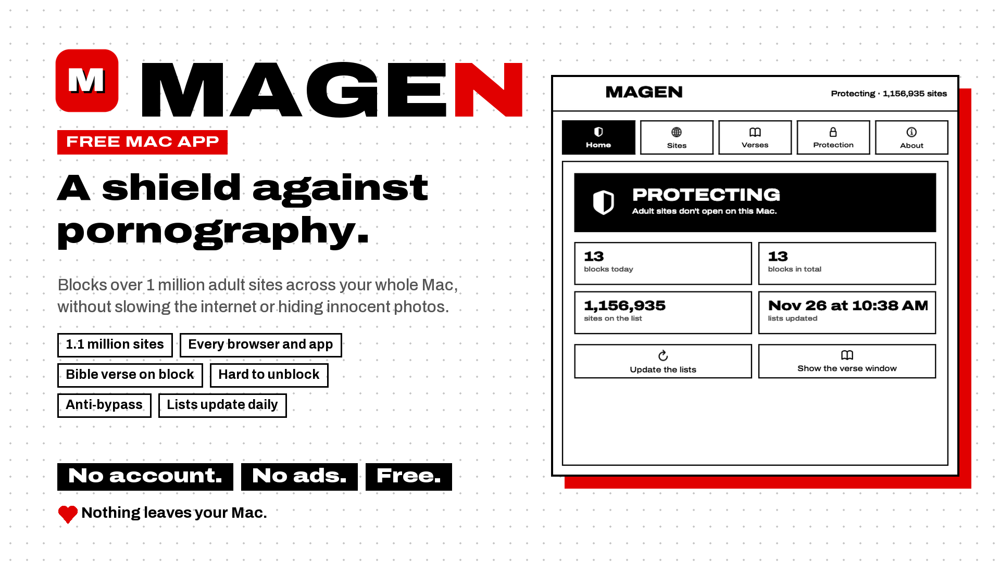
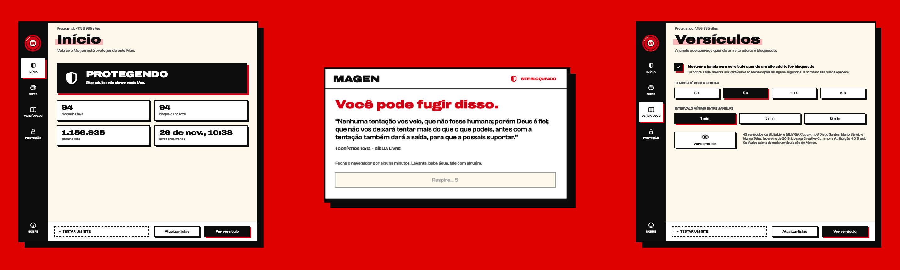

<p align="center">
  
</p>

<p align="center">
  <a href="README.md">Português</a> · <b>English</b>
</p>

<h3 align="center">
  <a href="https://github.com/movemontes/magen/releases/latest/download/Magen-mac.dmg">⬇️ Download for Mac</a>
</h3>

<p align="center">🌐 <a href="https://movemontes.github.io/magen/en/">movemontes.github.io/magen</a></p>

<p align="center">Free · No account · No ads · Nothing leaves your computer</p>

---

**Magen** (“shield” in Hebrew) is a free Mac app that blocks over **1 million adult websites** across your whole computer: every browser and every app. It doesn't slow the internet down and doesn't hide innocent photos of clothed people. When a site is blocked, the screen turns red and shows a **Bible verse**.

> The app is in Brazilian Portuguese for now. The verses come from the Bíblia Livre, a Portuguese translation.

## Why use it

- **It really blocks.** Over 1.1 million adult sites from three open lists that update themselves every day.
- **Your whole Mac.** Safari, Chrome, Firefox and any app, not just one browser.
- **No slowdown.** It only sees the site's *name*, never the page content (about 1 millisecond extra).
- **No silly blocks.** It doesn't look at photos, so it never hides clothed people.
- **A verse at the right time.** 43 verses, each with a short title. The site's name never appears.
- **Hard to get around.** Unblocking a site needs a typed sentence, the Mac password and only takes effect **1 hour later**. Sites with an obviously adult name can never be unblocked. It also blocks browsers' “secure DNS”.

<p align="center">
  
</p>

## How to install

1. [**Download Magen**](https://github.com/movemontes/magen/releases/latest/download/Magen-mac.dmg) (a `.dmg` file).
2. Open it and drag **Magen** to your **Applications** folder.
3. Open Magen. The first time, your Mac says it can't verify the app, because it's free and not from the App Store. Open **System Settings → Privacy & Security**, scroll to the bottom and click **Open Anyway**.
4. Click **Ligar a proteção** (“Turn on protection”) and enter your Mac password.

**Before turning it on:** turn off **iCloud Private Relay** (System Settings › your name › iCloud). With it on, some apps (like Claude and Gmail) lose internet access. Magen warns you and helps.

**You need:** a Mac with Apple silicon (M1 or newer) and macOS 13 or newer.

## How it works

Before opening a website, your Mac asks “what is this site's address?” (that's called DNS). Magen answers that question: if the site is on an adult-site list, the answer is “this site doesn't exist”. Everything else is looked up at Cloudflare (1.1.1.1).

- Lists: [OISD NSFW](https://oisd.nl), [Block List Project](https://github.com/blocklistproject/Lists) and [StevenBlack](https://github.com/StevenBlack/hosts) (“porn” extension), downloaded straight from the source.
- A built-in “never block” list protects big sites (Google, YouTube, Wikipedia…) from mistakes in the lists.
- If the internet hiccups, it answers with the last good address instead of “address not found”.
- When you remove Magen, your Mac's DNS goes back to what it was, and Magen's files go to the Trash.

## Honest limits

- It blocks **most** adult sites, never 100%. New ones appear every day.
- Anyone with the Mac's administrator password can turn it off.
- A VPN may use its own DNS and get around it.
- It doesn't block adult ads inside normal sites yet.

## Privacy

Magen has no account, collects no data and doesn't keep a list of the sites you visit. It only counts how many blocks happened, on your own Mac. It uses the internet to download the block lists once a day.

## Support

Magen is free and will stay free. I made it alone and I've got 5 mouths to feed 😅. If it helped you, please share it with someone who needs it.

Thank you so much! — Mateus

## For developers

Written in Swift (AppKit), no dependencies. Builds with Apple's command line tools (Xcode not required).

```bash
./montar-app.sh                 # builds Magen.app and the .dmg in dist/
.build/release/magen-selftest   # self-test (no internet, no password)
.build/release/magend --dir /tmp/magen --port 53535 --no-system-dns   # try it without touching your Mac
dig @127.0.0.1 -p 53535 example.com
```

- `Sources/magend`: the DNS service (runs as root via launchd).
- `Sources/magen`: command-line tool (`magen status`, `magen testar site.com`…).
- `Sources/MagenBar`: the app (menu bar, window, verses).
- `Resources/servico`: scripts that turn protection on and remove it.

## Credits and licenses

- Code: [MIT](LICENSE).
- Verses: **Bíblia Livre (BLIVRE)**, Copyright © Diego Santos, Mario Sérgio and Marco Teles, February 2018, [Creative Commons Attribution 4.0 Brazil](http://creativecommons.org/licenses/by/4.0/br/). The titles above the verses are Magen's.
- Font: [Archivo](https://github.com/Omnibus-Type/Archivo), SIL Open Font License (`Resources/fonts/OFL.txt`).
- Block lists: each project's own license; Magen does not redistribute them.
