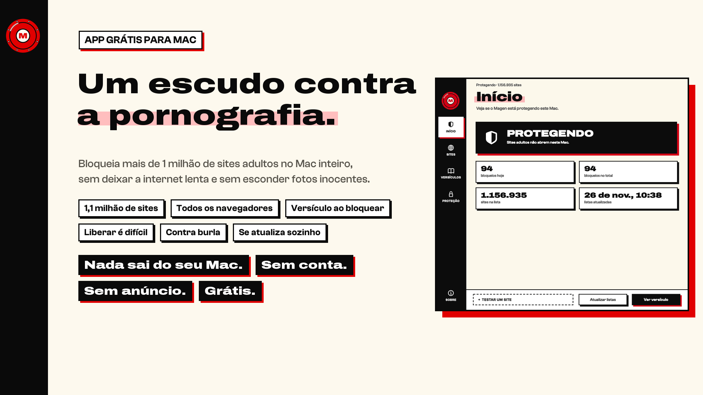
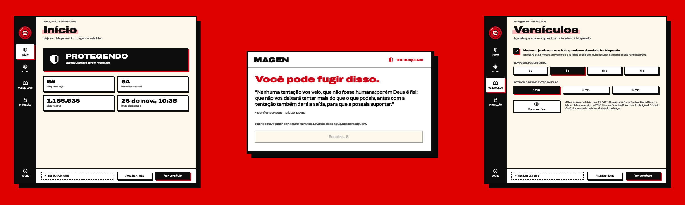

<p align="center">
  
</p>

<h3 align="center">
  <a href="https://github.com/movemontes/magen/releases/latest/download/Magen-mac.dmg">⬇️ Baixar para Mac</a>
</h3>

<p align="center">🌐 <a href="https://movemontes.github.io/magen/">movemontes.github.io/magen</a> · <a href="README.en.md">English</a></p>

<p align="center">Grátis · Sem conta · Sem anúncio · Nada sai do seu computador</p>

---

**Magen** (“escudo” em hebraico) é um app grátis para Mac que bloqueia mais de **1 milhão de sites adultos** no computador inteiro: em todos os navegadores e apps. Ele não deixa a internet lenta e não esconde fotos inocentes de pessoas vestidas. Quando um site é bloqueado, a tela fica vermelha e aparece um **versículo bíblico**.

## Por que usar

- **Bloqueia de verdade.** Mais de 1,1 milhão de sites adultos, de três listas abertas que se atualizam sozinhas todo dia.
- **Mac inteiro.** Safari, Chrome, Firefox e qualquer app, não só um navegador.
- **Não fica lento.** Ele só vê o *nome* do site, nunca o conteúdo das páginas (cerca de 1 milésimo de segundo a mais).
- **Sem bloqueio bobo.** Não olha fotos, então não esconde pessoas vestidas.
- **Versículo na hora certa.** 43 versículos da Bíblia Livre, com um título curto como “Você pode fugir disso.”. O nome do site nunca aparece.
- **Se atualiza sozinho e fala português e inglês.** Procura versão nova no GitHub uma vez por dia.
- **Difícil de burlar.** Liberar um site pede uma frase, a senha do Mac e só vale **1 hora depois**. Sites com nome claramente adulto nunca podem ser liberados. Também bloqueia o “DNS seguro” dos navegadores.

<p align="center">
  
</p>

## Como instalar

1. [**Baixe o Magen**](https://github.com/movemontes/magen/releases/latest/download/Magen-mac.dmg) (arquivo `.dmg`).
2. Abra o arquivo e arraste o **Magen** para a pasta **Aplicativos**.
3. Abra o Magen. Na primeira vez, o Mac avisa que não consegue verificar o app, porque ele é gratuito e não passou pela loja da Apple. Abra **Ajustes do Sistema → Privacidade e Segurança**, role até o fim e clique em **Abrir Mesmo Assim**.
4. Clique em **Ligar a proteção** e digite a senha do Mac.

**Antes de ligar:** desligue a **Retransmissão Privada do iCloud** (Ajustes do Sistema › seu nome › iCloud). Com ela ligada, alguns apps (como o Claude e o Gmail) ficam sem internet. O Magen avisa e ajuda.

**Precisa de:** Mac com chip Apple (M1 ou mais novo) e macOS 13 ou mais novo.

## Como funciona

Antes de abrir um site, o Mac pergunta “qual é o endereço deste site?” (isso se chama DNS). O Magen responde essa pergunta: se o site está numa lista de sites adultos, a resposta é “esse site não existe”. Os outros sites são consultados na Cloudflare (1.1.1.1).

- Listas: [OISD NSFW](https://oisd.nl), [Block List Project](https://github.com/blocklistproject/Lists) e [StevenBlack](https://github.com/StevenBlack/hosts) (extensão “porn”), baixadas direto da fonte.
- Uma lista de “nunca bloquear” protege sites grandes (Google, YouTube, Wikipedia, Globo…) de erros nas listas.
- Se a internet falhar por um instante, ele usa a última resposta boa, em vez de dizer “endereço não encontrado”.
- Ao remover o Magen, o DNS do Mac volta a ser o que era antes, e os arquivos vão para o Lixo.

## Limites (honestos)

- Bloqueia **a maioria** dos sites adultos, nunca 100%. Sites novos surgem todo dia.
- Quem tem a senha de administrador do Mac consegue desligar.
- Uma VPN ligada pode usar o próprio DNS e passar por fora.
- Ainda não bloqueia anúncios adultos dentro de sites normais.

## Privacidade

O Magen não tem conta, não coleta dados e não guarda a lista dos sites que você visita. Ele só conta quantos bloqueios aconteceram, no seu próprio Mac. Usa a internet para baixar as listas de bloqueio uma vez por dia.

## Apoie

O Magen é e vai continuar grátis. Fiz ele sozinho e tenho 5 bocas pra alimentar 😅. Se ele te ajudou, qualquer valor ajuda muito:

- **Pix** (chave aleatória, PicPay): `e2a1f4a9-ebfe-4c3c-a531-92a0e7433f14`

Obrigado de coração! — Mateus

## Para quem programa

Feito em Swift (AppKit), sem dependências. Compila com as ferramentas de linha de comando da Apple (não precisa do Xcode).

```bash
./montar-app.sh                 # compila, monta o Magen.app e o .dmg em dist/
.build/release/magen-selftest   # autoteste (sem internet, sem senha)
.build/release/magend --dir /tmp/magen --port 53535 --no-system-dns   # testa sem mexer no Mac
dig @127.0.0.1 -p 53535 exemplo.com
```

- `Sources/magend`: o serviço de DNS (roda como administrador, via launchd).
- `Sources/magen`: comando de Terminal (`magen status`, `magen testar site.com`…).
- `Sources/MagenBar`: o app (barra de menus, janela, versículos).
- `Resources/servico`: scripts que ligam e removem a proteção.

## Créditos e licenças

- Código: [MIT](LICENSE).
- Versículos em inglês: **World English Bible** (domínio público).
- Versículos: **Bíblia Livre (BLIVRE)**, Copyright © Diego Santos, Mario Sérgio e Marco Teles, fevereiro de 2018, [Creative Commons Atribuição 4.0 Brasil](http://creativecommons.org/licenses/by/4.0/br/). Os títulos acima dos versículos são do Magen.
- Fonte: [Archivo](https://github.com/Omnibus-Type/Archivo), SIL Open Font License (`Resources/fonts/OFL.txt`).
- Listas de bloqueio: licenças de cada projeto; o Magen não as redistribui.
